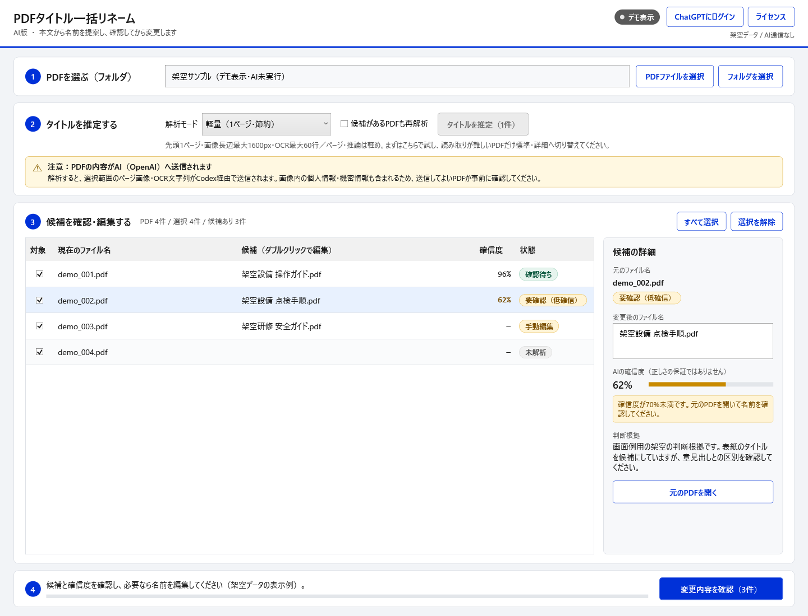
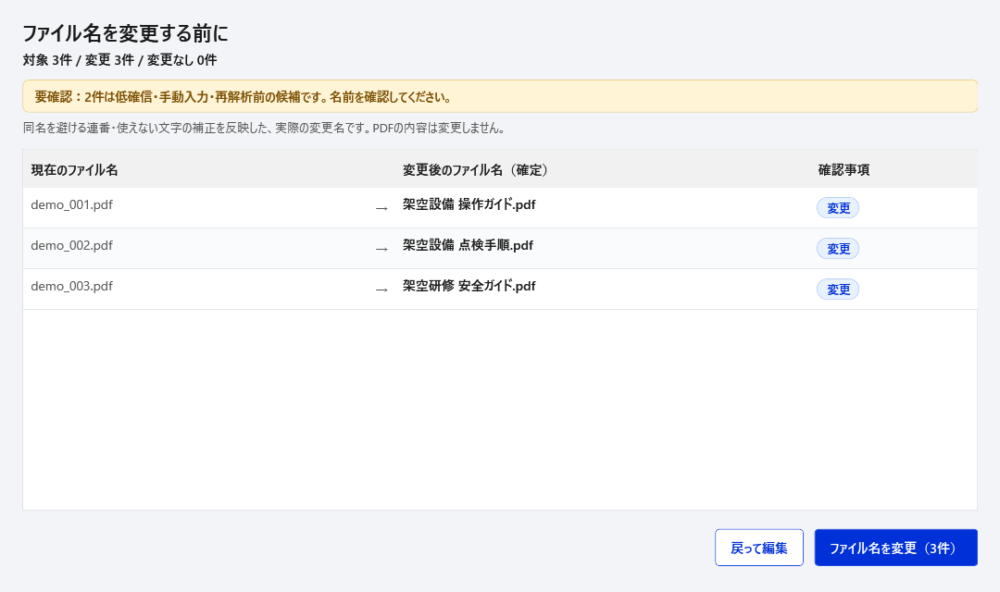

# PDFタイトル一括リネーム AI版

PDFの先頭ページをWindows OCRで読み取り、画像と文字レイアウトからCodexがタイトル候補を提案するWindowsアプリです。候補を確認・編集し、選んだPDFだけをリネームできます。

対象は1ファイル、または選択フォルダ直下のPDFです。先頭1・2・5ページ（既定は軽量・1ページ）を使い、PDFメタデータや現在のファイル名はAIの判断材料にしません。メタデータから名前を作る [PDF Title to Filename（非AI版）](https://github.com/fa-yoshinobu/PDF_Title_to_Filename) もあります。

[Windows x64版をダウンロード](https://github.com/fa-yoshinobu/PDF_Title_to_Filename_AI/releases/latest/download/PdfTitleRenamer_AI-win-x64.zip) · [SHA-256](https://github.com/fa-yoshinobu/PDF_Title_to_Filename_AI/releases/latest/download/PdfTitleRenamer_AI-win-x64.zip.sha256) · [変更履歴](CHANGELOG.md)

## 画面例

以下は現在のソース版の画面です。ファイル名・タイトル候補・確信度・判断根拠はすべて画面例用の架空データで、実際のPDFやAIの解析結果ではありません。公開済みのリリースとは画面や配布構成が異なる場合があります。



変更前には、連番や使えない文字の補正を反映した最終ファイル名を全件確認できます。



画像はWPFの描画からPNGで直接保存しています。原寸で確認する場合は画像を開いてください。

## 非AI版との使い分け

| 項目 | 非AI版 | このAI版 |
|---|---|---|
| 主な判断材料 | PDFメタデータ | 先頭1・2・5ページ（既定は軽量・1ページ）の画像とOCRレイアウト |
| 向いているPDF | Titleなどが正しく設定されたPDF | メタデータが空・不正確なPDF、スキャンPDF |
| AI通信 | なし | Codex経由でOpenAIへ送信 |
| 出力の性質 | 設定に基づく決定的な組み立て | 文書内容からの確率的な推定 |

PDFメタデータが信頼できる場合は非AI版、メタデータだけでは正式タイトルを判定できない場合はこのAI版が適しています。

詳細な機能要件、画面仕様、安全条件、制約、受入基準は [仕様書](docs/SPEC.md) を参照してください。

## AIへのデータ送信に関する注意

> **注意:** AI解析を実行すると、PDF先頭1・2・5ページ（既定は軽量・1ページ）の画像とOCR結果がCodex経由でOpenAIへアップロードされます。機密情報・個人情報を含むPDFは、所属組織や利用中のサービスの規則を確認してから処理してください。

PDFの現在のファイル名とメタデータはAIへ送信しません。ただし、ページ画像内に写っている文字、図、写真などはページ画像の一部として送信されます。この注意文はアプリのメイン画面にも常時表示します。

## 判定に使う情報

- 先頭1・2・5ページ（既定は軽量・1ページ）のページ画像
- OCR文字列
- OCR文字ブロックの位置と大きさ

PDFのタイトルプロパティ、作成者、現在のファイル名はAIの判断材料に使用しません。現在のファイル名は画面上の対応付けにだけ使用します。

## 必要環境

- Windows 10 バージョン2004（ビルド19041）以降、またはWindows 11（x64）
- .NETランタイムはEXEに同梱（別途インストール不要）
- Codex CLI
- ChatGPTアカウントでのCodexログイン
- 日本語OCRを使う場合はWindowsの日本語言語機能

PDFiumはアプリに同梱されるため、PDF表示ソフトやPopplerの別途インストールは不要です。APIキーも不要ですが、Codexによるタイトル判定ではOpenAIへの通信が発生し、利用中のChatGPTプランのCodex使用量を消費します。

## 解析モードと利用量の節約

「解析モード」は軽い順に並び、起動時は**軽量**です。ページ数・画像サイズ・AIへ渡すOCR情報量・推論量をまとめて切り替えます。

| モード | 読み取る範囲 | 画像の長辺上限 | OCR行数上限／ページ | 推論量 |
|---|---|---|---|---|
| 軽量（既定） | 先頭1ページ | 1600px | 60行 | 軽め（low） |
| 標準 | 先頭2ページ | 2400px | 150行 | 標準（medium） |
| 詳細 | 先頭5ページ | 2400px | 300行 | 詳しく（high） |

OCRは大きな文字の行を優先して選び、位置情報とともに送信します。軽量で判断が難しいPDFだけ標準・詳細へ切り替え、「候補があるPDFも再解析」を選んでやり直してください。自動で重いモードへ再解析することはありません。

軽量では小さい文字や複雑な表紙を読み違える場合があります。削減率や精度はPDFと利用モデルにより異なり、実AI通信での比較値は未測定です。

## PDF対応

- 通常PDFとスキャンPDFは、同じPDFium描画経路で処理します。
- 閲覧パスワードなしで開ける権限制限付きAES-256 PDFにも対応します。
- 開くためのパスワードが必要なPDFは、保護を解除してから処理してください。
- PDFiumが対応していないセキュリティ方式や破損PDFは、対象行を解析失敗として次のPDFへ進みます。

## Codex使用量の表示

解析中は画面上部に `利用枠 35%使用 / 今回 82,500 tokens` の形式で表示します。

- `今回` は、その一括解析でCodexへ送った入力、画像、推論、出力を含む合計トークン数です。
- 利用枠の使用率とリセット時刻は、契約プランから提供された場合だけ表示します。
- クレジット残高、個別上限、プラン種別は、提供された項目だけツールチップへ表示します。
- ChatGPTログイン方式のため、API料金の正確なドル・円換算は表示しません。

## 初回準備

PowerShellでログインします。

```powershell
codex login
codex login status
```

アプリ上部の「ChatGPTにログイン」からもログインできます。

## 使い方

1. `PdfTitleRenamer_AI.exe`を起動します。
2. 「PDFファイルを選択」または「フォルダを選択」を押します。PDF 1ファイルまたはフォルダ1個を画面へドラッグ＆ドロップすることもできます。ファイル選択では選んだ1件だけ、フォルダ選択では直下のPDFすべてをチェック済みで読み込みます。サブフォルダは検索しません。複数ファイルの同時ドロップには対応していません。
3. 解析対象にチェックを付け、「解析モード」を軽量・標準・詳細から選んで「タイトルを推定」を押します。通常は候補のないPDFだけを解析します。
4. 行を選ぶと右側に候補名・確信度・判断根拠を表示します。候補名は一覧または右側で編集できます。「元のPDFを開く」で照合できます。
5. 読み取り範囲を増やしてやり直す場合は「候補があるPDFも再解析」を選びます。成功時に既存候補を置き換え、失敗・中止時は旧候補と分かる状態で保持します。
6. リネーム対象だけにチェックを付けて「変更内容を確認」を押します。連番や文字補正を反映した全件の変更名を確認し、「ファイル名を変更」で実行します。

確信度が70%未満の候補は「要確認（低確信）」と表示します。確信度はAIの自己評価で、正しさを保証しません。ページ数を増やすと推定材料が増えますが、処理時間と利用量も増えます。

画面上部の「ライセンス」から、アプリのバージョン、MIT License、同梱コンポーネントの第三者ライセンス表示を確認できます。

同名ファイルがある場合は ` (2)`、` (3)` のような連番を付け、既存ファイルを上書きしません。Windowsで使えない文字は除去します。大文字・小文字だけを変える場合も、確認画面で変更として扱います。

## 開発用コマンド

アプリ本体は`src/PdfTitleRenamer`、仕様書は`docs`、検証コードは`tests`に配置しています。以下のコマンドはリポジトリ直下で実行します。

`build.bat`をダブルクリックすると、Releaseビルド、単一EXEの発行、ZIP作成をまとめて実行します。

```bat
build.bat
```

コマンドラインや自動処理から一時停止なしで実行する場合は、`build.bat --no-pause`を使用します。成果物は`artifacts\release\PdfTitleRenamer_AI.exe`と`artifacts\release\PdfTitleRenamer_AI-win-x64.zip`です。

生成物はすべて`artifacts`配下にまとめます。`build`はビルド結果、`intermediate`は中間ファイル、`publish`は配布用EXE 1個、`packages`はEXE 1個だけを収めた配布用ZIPです。`build`と`intermediate`はプロジェクト名ごとに分かれます。このフォルダとPythonのキャッシュはGitの管理対象に含めません。

```powershell
dotnet build .\src\PdfTitleRenamer\PdfTitleRenamer.csproj -c Release
dotnet run --project .\tests\behavior\BehaviorChecks.csproj -c Release
python -B -m unittest discover -s tests/release -v
dotnet format .\src\PdfTitleRenamer\PdfTitleRenamer.csproj --verify-no-changes --no-restore
dotnet publish .\src\PdfTitleRenamer\PdfTitleRenamer.csproj -c Release -o .\artifacts\release
```

アプリアイコン、単一EXE配布、高DPI設定は非AI版と共通の製品ファミリー構成です。

## UIの参考

[デジタル庁デザインシステム](https://design.digital.go.jp/dads/)のカラー・ボタン・読みやすさの指針を参考に、WPFで実装しています。公式コンポーネントの採用や適合認証を意味するものではありません。

## ライセンス

本ソフトウェア本体は [MIT License](LICENSE) で公開します。アプリ上部の「ライセンス」から本文を表示できます。PDFium、PDFtoImage、SkiaSharpなど同梱コンポーネントには、それぞれのライセンスが適用されます。概要とライセンス全文はEXEに埋め込んでおり、アプリ内の「第三者ライセンス」タブで確認できます。ソース上の文書は[THIRD-PARTY-NOTICES.txt](THIRD-PARTY-NOTICES.txt)と`ThirdPartyLicenses`にあります。

## Release distribution

The fixed-name ZIP and checksum links below are available for the current release. Older releases retain their original assets.

- [Latest Windows x64 ZIP](https://github.com/fa-yoshinobu/PDF_Title_to_Filename_AI/releases/latest/download/PdfTitleRenamer_AI-win-x64.zip)
- [ZIP SHA-256 checksum](https://github.com/fa-yoshinobu/PDF_Title_to_Filename_AI/releases/latest/download/PdfTitleRenamer_AI-win-x64.zip.sha256)
- [Changelog](CHANGELOG.md) / [TODO](TODO.md)

Extract the ZIP file and run `PdfTitleRenamer_AI.exe`. The current source builds a ZIP containing only this executable, with full license texts available in the app's license window. For older releases, follow the instructions in that release's notes.

Windows 10 version 2004 or later, or Windows 11 (x64). The .NET runtime and PDFium are included. AI analysis requires Codex CLI and a signed-in account. Light (default), Standard and Detailed modes use the first 1, 2 or 5 PDF pages respectively, with different image, OCR and reasoning limits. Images and OCR text are sent to OpenAI through Codex; review your data handling requirements before using it.

Release notes and VirusTotal scan messages are in English. Existing project documents may keep their current language.

Maintainers: update the English Changes section in `.github/release-notes.md` from the relevant CHANGELOG entries before releasing. The release workflow publishes the ZIP and checksum, then scans the actual published executables. Use the `Scan release with VirusTotal` workflow with a release tag to retry an incomplete scan. See the [shared release standard](https://github.com/fa-yoshinobu/release_standard).

ローカル配布物は `build.bat` で作成します。起動EXEは `artifacts/release/PdfTitleRenamer_AI.exe`、配布ZIPは `artifacts/release/PdfTitleRenamer_AI-win-x64.zip`、SHA-256は同ZIPの `.sha256` です。ZIPを展開し、EXEを直接起動してください。旧出力フォルダーは自動削除しません。
